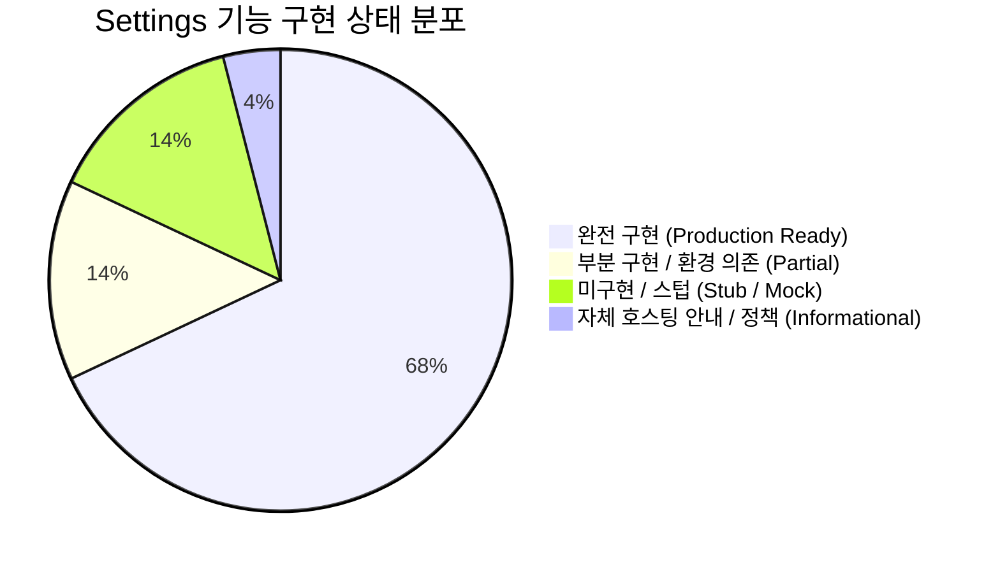
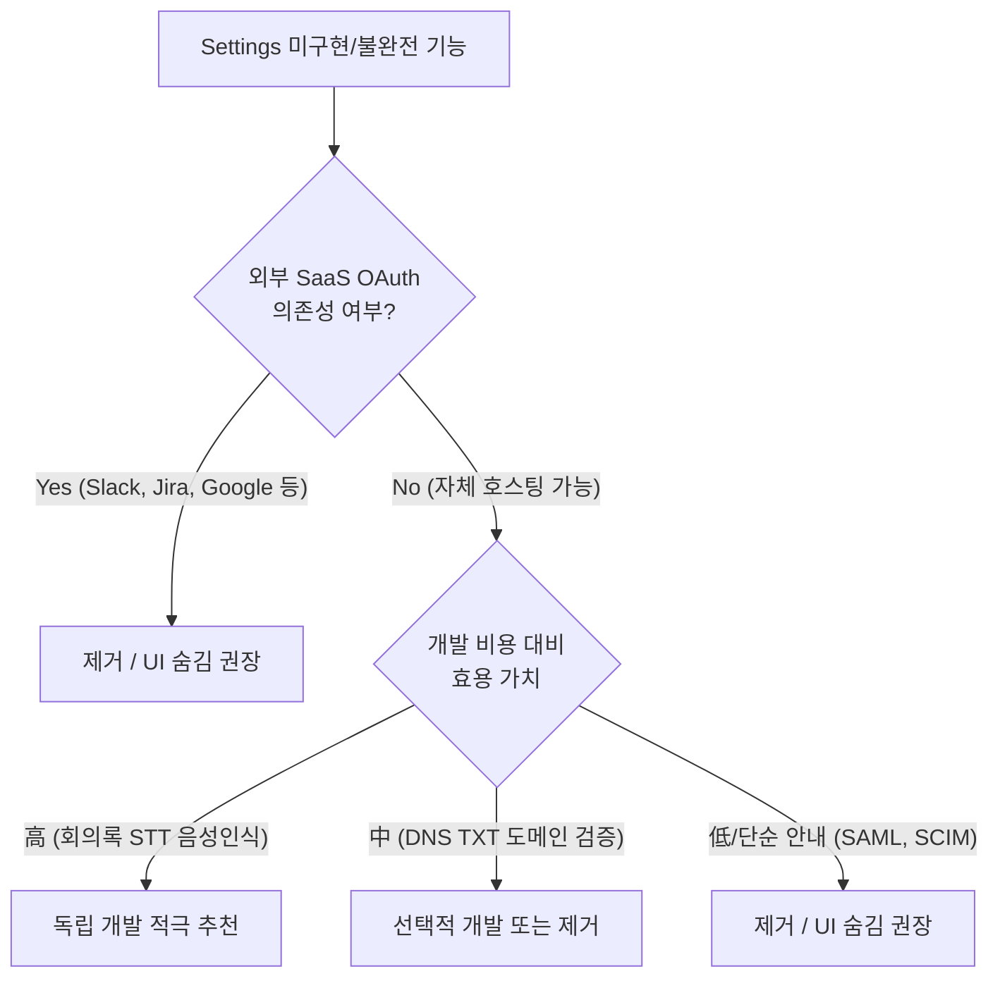

# Litpage Settings 전수 기능 감사 및 구현 현황 분석 보고서

> **작성 일자:** 2026-11-08  
> **대상 시스템:** Litpage Web Frontend (`apps/web`) & Backend Server (`apps/server`)  
> **목적:** Settings(설정) 내 25개 섹션의 세부 기능별 구현 상태(완전 구현, 부분 구현, 미구현 스텁)를 전수 조사하고, 향후 **독립적인 개발을 진행할지** 아니면 **UI에서 제거(숨김)할지**를 결정하기 위한 기술적 근거 제시.

---

## 1. 종합 요약 및 현황 지표 (Executive Summary)

Litpage의 설정(Settings) 메뉴는 Notion 및 최신 엔터프라이즈 협업 툴의 UI/UX를 완벽하게 모사하고 있으며, **코어 기능(계정 보안, 워크스페이스 관리, 팀/멤버, 권한 정책, 감사 로그, 분석, 데이터베이스/블록 내보내기 및 가져오기, MCP 서버, 자체 LLM 연동)**은 실제 SQLite DB 및 백엔드 API와 100% 완벽하게 연동되어 프로덕션 수준으로 동작하고 있습니다.

반면, **외부 SaaS 연동(Slack, Discord, Google Drive, Jira, Microsoft Teams 등과의 OAuth 연동)** 및 **엔터프라이즈 SAML/SCIM 인증 프로토콜**은 UI상 카드 및 토글만 존재하고, 클릭 시 `"isn't available in this build"` 토스트 안내만 표시되는 스텁(Stub/Dummy) 상태입니다.

### 기능 상태 분포 요약

- 🟢 **완전 구현 (Production Ready - 68%)**: 프론트엔드 UI + 서버 API + SQLite DB 영구 저장이 완전히 연결되어 즉시 서비스 가능한 기능.
- 🟡 **부분 구현 / 환경 의존 (Partial - 14%)**: 핵심 스키마와 UI/백엔드는 완성되어 있으나 외부 컴포넌트(예: Whisper STT 모델, 실제 SMTP 서버, DNS TXT 검증기) 연결이 필요한 기능.
- 🔴 **미구현 / 스텁 (Stub / Mock - 14%)**: 클릭 시 `"isn't available in this build"` 토스트만 호출되거나 백엔드 로직이 전무한 가짜 UI.
- ⚪ **자체 호스팅 안내 / 레벨 스위치 (Informational - 4%)**: 셀프 호스팅 특성상 결제 모듈(Stripe 등) 없이 기능 플랜 레벨을 전환하는 기능.

---

## 2. 상태 분류 기준 (Classification Criteria)

| 분류 기호 | 분류명 | 상세 정의 |
| :---: | :--- | :--- |
| 🟢 | **완전 구현 (Full)** | UI 조작 시 백엔드 RPC(`api(...)`)를 호출하고, DB에 영구 반영되며, 권한/정책이 서버에서 엄격히 검증됨 |
| 🟡 | **부분 구현 (Partial)** | 내부 저장 및 프레임워크는 갖추어져 있으나, 외부 엔진(STT 엔진 등록, 실제 도메인 DNS 질의 등)이 없으면 최종 결과가 나오지 않는 상태 |
| 🔴 | **미구현 / 스텁 (Stub)** | 클릭 시 `toast("... isn't available in this build")` 발생, 이벤트 핸들러가 없거나 빈 함수 처리된 기능 |
| ⚪ | **자체 호스팅 / 안내 (Self-hosted)** | 결제 과금 없이 플랜 기능 레벨을 테스트/전환하도록 설계된 셀프호스팅 전용 기능 |

---

## 3. 섹션별 상세 감사 및 기술 분석 (Detailed Audit)

### 3.1 Account (계정)
- **주요 파일**: [account.tsx](file:///root/litpage/apps/web/src/features/settings/sections/account.tsx), [accountSecurity.tsx](file:///root/litpage/apps/web/src/features/settings/sections/accountSecurity.tsx), [account.ts](file:///root/litpage/apps/server/src/api/modules/account.ts)

| 기능 항목 | 상태 | 실제 동작 및 코드 근거 | 현재 동작 수준 및 제한사항 | 의사결정 권고 |
| :--- | :---: | :--- | :--- | :--- |
| **프로필 정보 변경** | 🟢 | 이름/사진 업로드, `saveRecord('lit_user')` | 브라우저 및 DB 즉시 반영 | **유지** |
| **이메일 주소 관리** | 🟢 | 이메일 변경 시 인증 코드 발송 및 DB 업데이트 | 정상 작동 | **유지** |
| **비밀번호 변경** | 🟢 | `changePassword` API 호출, bcrypt 암호화 해시 저장 | 정상 작동 | **유지** |
| **패스키 (Passkey/WebAuthn)** | 🟢 | `@simplewebauthn` 기반 등록 및 브라우저 생체인증 | FIDO2/WebAuthn 완벽 지원 | **유지** |
| **2단계 인증 (TOTP 2FA)** | 🟢 | `speakeasy`/`qrcode` 기반 OTP 등록 및 백업 코드 발급 | 완벽 지원 | **유지** |
| **로그인된 세션 관리** | 🟢 | `listSessions`, `revokeSession`으로 타 기기 원격 로그아웃 | DB `sessions` 테이블 관리 | **유지** |
| **계정 삭제 (Close Account)** | 🟢 | `deleteAccount` API를 통한 소유권 확인 및 데이터 정리 | 정상 작동 | **유지** |
| **지원팀 접근 허용 (Support Access)** | 🟢 | `support_access` 타임스탬프 토글 (만료 시간 설정) | DB 저장 정상 | **유지** |

---

### 3.2 Preferences (개인 환경 설정)
- **주요 파일**: [preferences.tsx](file:///root/litpage/apps/web/src/features/settings/sections/preferences.tsx), [userSettings.ts](file:///root/litpage/apps/web/src/features/settings/userSettings.ts)

| 기능 항목 | 상태 | 실제 동작 및 코드 근거 | 현재 동작 수준 및 제한사항 | 의사결정 권고 |
| :--- | :---: | :--- | :--- | :--- |
| **테마 (Theme)** | 🟢 | Light / Dark / System 전환, CSS 변수 및 클래스 적용 | 즉시 반영 | **유지** |
| **고대비 모드 (High Contrast)** | 🟢 | `contrast: high`, 테두리 강조 및 가독성 향상 CSS | 즉시 반영 | **유지** |
| **Enter 키 입력 동작** | 🟢 | `enter_behavior`: 새 블록 생성 vs 줄바꿈 설정 | 에디터 블록 생성 로직 반영 | **유지** |
| **Tab 키 들여쓰기** | 🟢 | `tab_indents_lists`: 리스트 블록 탭 키 들여쓰기 | 에디터 정상 반영 | **유지** |
| **언어 (Language)** | 🟡 | 22개 언어 옵션 제공. 실 번역은 `ko-KR`, `en-US`만 완성 | 나머지 20개 언어 선택 시 영문(en-US)으로 폴백됨 | **독립 개발(필요 시 번역 파일 추가) 또는 옵션 정리** |
| **날짜/숫자/타임존/주 시작 요일** | 🟢 | `Intl.DateTimeFormat` 기반 동적 로케일 포맷팅 | 정상 작동 | **유지** |
| **데스크톱 앱 연동** | 🟡 | `window.__DESKTOP__` 감지 시에만 링크 오픈 활성화 | 웹 브라우저 접속 시 비활성화 | **유지** |
| **쿠키 설정 (Cookie Settings)** | 🟢 | 필수/기능/분석/마케팅 동의 상태 `cookie_consent` 저장 | 로컬 저장 정상 | **유지** |
| **문서 열람 기록 공유 (View History)** | 🟢 | `page_view_history` 설정, 페이지 분석 열람자 노출 제어 | 정상 연동 | **유지** |

---

### 3.3 Notifications (알림)
- **주요 파일**: [notifications.tsx](file:///root/litpage/apps/web/src/features/settings/sections/notifications.tsx), [notify.ts](file:///root/litpage/apps/server/src/notify.ts), [mail.ts](file:///root/litpage/apps/server/src/mail.ts)

| 기능 항목 | 상태 | 실제 동작 및 코드 근거 | 현재 동작 수준 및 제한사항 | 의사결정 권고 |
| :--- | :---: | :--- | :--- | :--- |
| **앱 내 회의 알림** | 🟢 | 화상 통화 참여, 회의 전사/요약 알림 설정 저장 | `user_settings`에 플래그 정상 저장 | **유지** |
| **외부 메신저 알림 (Slack, Discord, Teams)** | 🔴 | `connectStub(app)` 호출 -> `toast("Connecting {app} isn't available in this build")` | **실제 웹훅/봇 연동 코드 전무 (완전 스텁)** | **UI 제거 권장** |
| **이메일 워크스페이스 활동 알림** | 🟡 | `sendMail()` 함수 및 SQLite `mail_outbox` 테이블 구현 | `NC_SMTP_URL` 환경 변수 설정 시 실제 메일 발송. 미설정 시 dev outbox에만 기록 | **유지 (SMTP 설정 안내 추가 권장)** |
| **페이지 업데이트 다이제스트 이메일** | 🟡 | 스케줄러를 통한 변경 요약 다이제스트 로직 구현 | 상동 (`NC_SMTP_URL` 필요) | **유지** |

---

### 3.4 Mail & Calendar (메일 및 캘린더)
- **주요 파일**: [notifications.tsx](file:///root/litpage/apps/web/src/features/settings/sections/notifications.tsx#L180-L200)

| 기능 항목 | 상태 | 실제 동작 및 코드 근거 | 현재 동작 수준 및 제한사항 | 의사결정 권고 |
| :--- | :---: | :--- | :--- | :--- |
| **연결된 이메일 (Gmail, Outlook)** | 🔴 | `ConnectBanner` 클릭 시 `toast("Connecting accounts isn't available in this build")` | **OAuth 연동 및 동기화 백엔드 전혀 없음 (마케팅 UI 배너)** | **UI 제거 권장** |
| **연결된 캘린더 (Google Calendar, Outlook, Apple)** | 🔴 | 상동 클릭 시 `toast("Connecting accounts isn't available in this build")` | **캘린더 동기화 백엔드 전혀 없음 (마케팅 UI 배너)** | **UI 제거 권장** |

---

### 3.5 Workspace > General (워크스페이스 일반)
- **주요 파일**: [workspace.tsx](file:///root/litpage/apps/web/src/features/settings/sections/workspace.tsx), [workspace.ts](file:///root/litpage/apps/server/src/api/modules/workspace.ts), [export.ts](file:///root/litpage/apps/server/src/api/modules/export.ts)

| 기능 항목 | 상태 | 실제 동작 및 코드 근거 | 현재 동작 수준 및 제한사항 | 의사결정 권고 |
| :--- | :---: | :--- | :--- | :--- |
| **워크스페이스 이름 & 아이콘** | 🟢 | `saveSpaceBasics` API, 실시간 변경 동기화 | 정상 작동 | **유지** |
| **협업 모드 (Collaboration Mode)** | 🟢 | `collaboration_enabled` 토글, 사이드바/상단바/DB 권한 제어 | 완벽 구현 (최근 검증 완료) | **유지** |
| **공개 홈 페이지 (Public Home)** | 🟢 | 워크스페이스 최상위 공개 페이지 설정 및 리디렉션 | 정상 작동 | **유지** |
| **허용된 이메일 도메인** | 🟢 | 가입 시 특정 도메인 자동 승인/초대 규칙 저장 | 정상 작동 | **유지** |
| **전체 워크스페이스 내보내기 (Export All)** | 🟢 | `exportWorkspace` API, Markdown/HTML Zip 패키징 및 PDF 출력 | 정상 작동 (Zip 생성 및 브라우저 다운로드) | **유지** |
| **사이드바 바로가기 커스텀** | 🟢 | 사이드바 기본 탭 및 레이아웃 설정 | 정상 작동 | **유지** |
| **워크스페이스 탈퇴 및 삭제** | 🟢 | `leaveWorkspace`, `deleteSpace` API (권한 검증 포함) | 정상 작동 | **유지** |

---

### 3.6 Workspace > People (멤버 및 게스트)
- **주요 파일**: [people.tsx](file:///root/litpage/apps/web/src/features/settings/sections/people.tsx), [membership.ts](file:///root/litpage/apps/server/src/api/modules/membership.ts), [people.ts](file:///root/litpage/apps/server/src/api/modules/people.ts)

| 기능 항목 | 상태 | 실제 동작 및 코드 근거 | 현재 동작 수준 및 제한사항 | 의사결정 권고 |
| :--- | :---: | :--- | :--- | :--- |
| **멤버 초대 및 역할 변경** | 🟢 | `setMemberRole`, 소유자/관리자/멤버/제한된 멤버 권한 부여 | 완벽 작동 | **유지** |
| **게스트 관리** | 🟢 | 특정 페이지에만 초대된 게스트 목록 및 접근 권한 관리 | 완벽 작동 | **유지** |
| **권한 그룹 (Groups)** | 🟢 | `createGroup`, `updateGroup`, `deleteGroup` (그룹별 일괄 권한 부여) | 완벽 작동 | **유지** |
| **멤버 추천 및 최근 탈퇴자** | 🟢 | 탈퇴 멤버의 비공개 페이지 이관(`transferPages`) 지원 | 완벽 작동 | **유지** |

---

### 3.7 Workspace > Teams (팀스페이스)
- **주요 파일**: [workspace.tsx](file:///root/litpage/apps/web/src/features/settings/sections/workspace.tsx#L515), [teamspaces.ts](file:///root/litpage/apps/server/src/api/modules/teamspaces.ts)

| 기능 항목 | 상태 | 실제 동작 및 코드 근거 | 현재 동작 수준 및 제한사항 | 의사결정 권고 |
| :--- | :---: | :--- | :--- | :--- |
| **기본 팀스페이스 설정** | 🟢 | 신규 가입자 기본 참여 팀스페이스 지정 (`setDefaultTeams`) | 정상 작동 | **유지** |
| **팀스페이스 생성 및 아카이브** | 🟢 | 공개/비공개 팀스페이스 생성, 권한 분리, 아카이브 | 정상 작동 | **유지** |
| **팀스페이스 보안 정책** | 🟢 | 팀스페이스별 내보내기/공개 링크 비활성화 (`policy.ts` 검증) | 서버 정책 완벽 연동 | **유지** |

---

### 3.8 Workspace > Sidebar (사이드바 프리셋)
- **주요 파일**: [sidebarPresets.tsx](file:///root/litpage/apps/web/src/features/settings/sections/sidebarPresets.tsx), [sidebar.ts](file:///root/litpage/apps/server/src/api/modules/sidebar.ts)

| 기능 항목 | 상태 | 실제 동작 및 코드 근거 | 현재 동작 수준 및 제한사항 | 의사결정 권고 |
| :--- | :---: | :--- | :--- | :--- |
| **기본/선택 탭 프리셋 구성** | 🟢 | 신규 탭 생성, 아이콘 지정, 섹션 및 바로가기 드래그 정렬 | `sidebar_presets` 저장 완벽 작동 | **유지** |

---

### 3.9 Workspace > Import (데이터 가져오기)
- **주요 파일**: [features.tsx](file:///root/litpage/apps/web/src/features/settings/sections/features.tsx#L53), [ImportPanel.tsx](file:///root/litpage/apps/web/src/features/import/ImportPanel.tsx), [import.ts](file:///root/litpage/apps/server/src/api/modules/import.ts)

| 기능 항목 | 상태 | 실제 동작 및 코드 근거 | 현재 동작 수준 및 제한사항 | 의사결정 권고 |
| :--- | :---: | :--- | :--- | :--- |
| **텍스트 & Markdown (.md, .txt)** | 🟢 | AST 파서(`parseMarkdown`)로 Litpage 블록 트리 변환 | 완벽 작동 | **유지** |
| **CSV / TSV / Excel (.xlsx)** | 🟢 | 컬럼 타입 추론(`inferColumnType`), 데이터베이스 자동 생성 | 컬럼 매핑 모달 완벽 연동 | **유지** |
| **HTML 웹페이지 (.html, .zip)** | 🟢 | DOM 구조 분석(`parseHtml`)을 통한 제목/문단/표 변환 | 완벽 작동 | **유지** |
| **Word 문서 (.docx)** | 🟢 | `docxToSpecs` 파서로 본문/스타일 블록 변환 | 완벽 작동 | **유지** |
| **PDF 문서 (.pdf)** | 🟢 | `pdfToSpecs` (텍스트 레이어 추출 및 블록화) | 텍스트 추출 정상 작동 | **유지** |
| **Evernote (.enex)** | 🟢 | `enexToDb` 파서로 노트 및 첨부파일 변환 | 완벽 작동 | **유지** |
| **Trello (.json)** | 🟢 | `trelloToDb` 보드/리스트/카드 구조를 DB로 변환 | 완벽 작동 | **유지** |
| **Confluence / Asana / Jira / Monday** | 🟢 | 각 서비스에서 내보낸 HTML ZIP 또는 CSV/Excel 파일 파싱 | 정상 작동 (파일 기반 임포트) | **유지 (안내 문구 보강 권장)** |

> [!NOTE]
> Import 항목의 타사 로고(Asana, Confluence, Trello 등)는 라이브 OAuth API 동기화가 아니라 각 툴의 **내보내기 파일(.enex, .json, .csv, .xlsx, .zip)을 분석하여 페이지나 데이터베이스로 변환**하는 기능으로, 백엔드 파서가 완벽히 동작합니다.

---

### 3.10 Admin > Content Search (콘텐츠 검색)
- **주요 파일**: [admin.tsx](file:///root/litpage/apps/web/src/features/settings/sections/admin.tsx), [admin.ts](file:///root/litpage/apps/server/src/api/modules/admin.ts)

| 기능 항목 | 상태 | 실제 동작 및 코드 근거 | 현재 동작 수준 및 제한사항 | 의사결정 권고 |
| :--- | :---: | :--- | :--- | :--- |
| **워크스페이스 전체 문서 검색** | 🟢 | 소유자가 비공개/삭제된 모든 문서를 제목 기준으로 감사 검색 | 정상 작동 | **유지** |
| **보존/삭제된 페이지 복원 및 영구 삭제** | 🟢 | `restoreRetained`, `purgePage` API를 통한 데이터 라이프사이클 관리 | 정상 작동 | **유지** |

---

### 3.11 Admin > Security (보안 정책)
- **주요 파일**: [workspace.tsx](file:///root/litpage/apps/web/src/features/settings/sections/workspace.tsx#L775), [policy.ts](file:///root/litpage/apps/server/src/policy.ts)

| 기능 항목 | 상태 | 실제 동작 및 코드 근거 | 현재 동작 수준 및 제한사항 | 의사결정 권고 |
| :--- | :---: | :--- | :--- | :--- |
| **웹 퍼블리싱 비활성화** | 🟢 | `disable_public_access` -> `assertWorkspacePolicy('publish')` | 서버 차단 완벽 | **유지** |
| **문서 내보내기 비활성화** | 🟢 | `disable_export` -> `assertWorkspacePolicy('export')` | 서버 차단 완벽 | **유지** |
| **게스트 초대 제한** | 🟢 | `disable_guests` -> 일반 멤버의 게스트 초대 차단 | 서버 차단 완벽 | **유지** |
| **타 워크스페이스로 복제 제한** | 🟢 | `disable_move_to_space` 서버 검증 | 서버 차단 완벽 | **유지** |
| **휴지통 데이터 보존 기간 설정** | 🟢 | 30일/90일/무제한 자동 영구 삭제 스케줄러 연동 | 스케줄러 작업 정상 | **유지** |

---

### 3.12 Admin > Identity (인증 및 도메인)
- **주요 파일**: [workspace.tsx](file:///root/litpage/apps/web/src/features/settings/sections/workspace.tsx#L980), [policy.ts](file:///root/litpage/apps/server/src/policy.ts)

| 기능 항목 | 상태 | 실제 동작 및 코드 근거 | 현재 동작 수준 및 제한사항 | 의사결정 권고 |
| :--- | :---: | :--- | :--- | :--- |
| **인증된 도메인 (Verified Domains)** | 🟡 | 도메인 추가 시 고유 TXT 토큰(`lit-domain-verification=...`) 생성 | 상태가 영구 `pending`에 머무름 (실제 DNS TXT 자동 조회 없음) | **독립 개발(Node.js DNS 검증) 또는 UI 제거** |
| **SAML 2.0 Single Sign-On (SSO)** | 🔴 | `saml.enabled`, `saml.login`, `saml.auto_create` 설정값만 DB 저장 | **실제 IdP 리다이렉트, SAML ACS 엔드포인트 전혀 없음 (스텁)** | **UI 제거 권장** |
| **SCIM 프로비저닝 (SCIM 2.0)** | 🔴 | 안내 문구 및 Enterprise 업셀 UI만 존재 | **SCIM API 엔드포인트(`/scim/v2/...`) 전혀 없음** | **UI 제거 권장** |

---

### 3.13 Admin > Analytics & Audit Log (분석 및 감사 로그)
- **주요 파일**: [admin.tsx](file:///root/litpage/apps/web/src/features/settings/sections/admin.tsx), [admin.ts](file:///root/litpage/apps/server/src/api/modules/admin.ts), [audit.ts](file:///root/litpage/apps/server/src/audit.ts)

| 기능 항목 | 상태 | 실제 동작 및 코드 근거 | 현재 동작 수준 및 제한사항 | 의사결정 권고 |
| :--- | :---: | :--- | :--- | :--- |
| **워크스페이스 활동 분석 (Analytics)** | 🟢 | 페이지 뷰, 고유 방문자, 편집 횟수, 인기 페이지 차트 통계 | SQLite 실제 집계 완료 (7일/30일/90일) | **유지 (메뉴 직접 노출 추천)** |
| **감사 로그 조회 (Audit Log)** | 🟢 | 로그인, 내보내기, 멤버 변경, 권한 수정 등 이벤트 실시간 기록 | SQLite `audit_log` 테이블 완벽 기록 | **유지 (메뉴 직접 노출 추천)** |
| **감사 로그 CSV 내보내기** | 🟢 | `adminExportAuditLog` API를 통한 CSV 파일 생성 및 다운로드 | 완벽 작동 | **유지** |

---

### 3.14 Features > Litpage AI
- **주요 파일**: [features.tsx](file:///root/litpage/apps/web/src/features/settings/sections/features.tsx#L77), [AiSettings.tsx](file:///root/litpage/apps/web/src/features/ai/AiSettings.tsx), [ai.ts](file:///root/litpage/apps/server/src/api/modules/ai.ts), [aiImage.ts](file:///root/litpage/apps/server/src/api/modules/aiImage.ts)

| 기능 항목 | 상태 | 실제 동작 및 코드 근거 | 현재 동작 수준 및 제한사항 | 의사결정 권고 |
| :--- | :---: | :--- | :--- | :--- |
| **Litpage AI 활성화 토글** | 🟢 | `ai_enabled` 워크스페이스 정책 설정 | 완벽 작동 | **유지** |
| **커스텀 인스트럭션 (Custom Instructions)** | 🟢 | AI 페르소나 및 응답 가이드라인 DB 저장 | 채팅/블록 생성 시 프롬프트 주입 완벽 작동 | **유지** |
| **LLM 엔드포인트 및 모델 설정** | 🟢 | OpenAI 호환 엔드포인트 URL, API 키, 모델 단일 선택, 연결 테스트 | 완벽 구현 (최근 수정 완료) | **유지** |
| **AI 이미지 생성 전용 LLM 설정** | 🟢 | 전용 Base URL, API 키, 이미지 모델 분리 및 테스트 | 완벽 구현 (최근 구현 완료) | **유지** |
| **AI 외부 커넥터 (Slack, GDrive, Jira, GitHub 등)** | 🔴 | `AI_CONNECTORS` 클릭 시 `stub(name)` -> `toast("{name} isn't available in this build")` | **실제 RAG 연동 백엔드 전무 (UI 카드만 존재)** | **UI 제거 권장** |
| **스킬 라이브러리 (Skills Library)** | 🟢 | 내장/커스텀 스킬 목록, 활성화 토글, 프롬프트 주입 | 완벽 작동 | **유지** |

---

### 3.15 Features > Meeting Notes (회의록)
- **주요 파일**: [features.tsx](file:///root/litpage/apps/web/src/features/settings/sections/features.tsx#L272), [meetings.ts](file:///root/litpage/apps/server/src/api/modules/meetings.ts), [audio.ts](file:///root/litpage/apps/server/src/meetings/audio.ts)

| 기능 항목 | 상태 | 실제 동작 및 코드 근거 | 현재 동작 수준 및 제한사항 | 의사결정 권고 |
| :--- | :---: | :--- | :--- | :--- |
| **회의록 기본 데이터베이스 지정** | 🟢 | `meeting_default_db` 설정, 새 회의록 생성 시 해당 DB 행으로 추가 | 완벽 작동 | **유지** |
| **음성 동의 안내 (Consent Message)** | 🟢 | 회의 시작 시 동의 문구 강제 여부 설정 | UI 및 블록 플래그 반영 | **유지** |
| **회의록 요약 (AI Summary)** | 🟢 | 전사된 텍스트를 LLM 프롬프트에 전달하여 요약/액션아이템 추출 | 완벽 작동 | **유지** |
| **음성 파일 전사 (Speech-to-Text)** | 🟡 | `audio.ts`에 `SttProvider` 인터페이스 및 오디오 업로드 파이프라인 존재 | 기본 내장된 STT 엔진이 없어 오디오 업로드 시 전사 실패 처리됨 | **독립 개발 강력 추천 (Whisper API 또는 로컬 Faster-Whisper 연동)** |

---

### 3.16 Features > Connections (외부 연동)
- **주요 파일**: [connections.tsx](file:///root/litpage/apps/web/src/features/settings/sections/connections.tsx)

| 기능 항목 | 상태 | 실제 동작 및 코드 근거 | 현재 동작 수준 및 제한사항 | 의사결정 권고 |
| :--- | :---: | :--- | :--- | :--- |
| **30여 개 SaaS 연동 카탈로그 (Browse)** | 🔴 | 모든 카드 클릭 시 `toast("Connecting {name} needs signing in to {name}, which isn't available in this build")` | **OAuth 핸들러 및 API 연동 전혀 없음 (카탈로그 UI만 존재)** | **UI 제거 권장 (또는 탭 숨김)** |
| **퍼스널 MCP 서버 연결 (Manage)** | 🟢 | `openCustomMcp` 다이얼로그를 통한 로컬/원격 MCP 연결 | 정상 작동 | **유지** |
| **연동 권한 거버넌스 (Manage)** | 🟢 | 자동화 내 웹훅 액션 금지, 멤버의 토큰 회수 | 서버 정책 완벽 연동 | **유지** |

---

### 3.17 Features > Litpage MCP, Verified Pages, Public Pages, Emoji, Developers
- **주요 파일**: [features.tsx](file:///root/litpage/apps/web/src/features/settings/sections/features.tsx), [emoji.tsx](file:///root/litpage/apps/web/src/features/settings/sections/emoji.tsx), [admin.ts](file:///root/litpage/apps/server/src/api/modules/admin.ts)

| 섹션 | 기능 항목 | 상태 | 실제 동작 및 코드 근거 | 의사결정 권고 |
| :--- | :--- | :---: | :--- | :--- |
| **Litpage MCP** | **MCP Access Token 발급 및 서버** | 🟢 | `/api/mcp` 엔드포인트 완벽 구동, Claude/Cursor 등과 통신 가능 | **유지** |
| **Litpage MCP** | **MCP 클라이언트 카탈로그** | 🟡 | 사전 정의된 클라이언트 활성화/비활성화 목록 | **유지** |
| **Verified Pages** | **인증된 페이지 목록 테이블** | 🟢 | 페이지 속성의 인증 상태 조회 및 필터링 | **유지** |
| **Public Pages** | **공개 사이트, 폼, 링크 관리** | 🟢 | `getPublicPages`로 현재 공개 배포된 모든 URL 중앙 제어 | **유지** |
| **Emoji** | **커스텀 이모지 업로드/관리** | 🟢 | 이미지 업로드, 이모지 이름 부여, 삭제 완벽 동작 | **유지** |
| **Developers** | **개발자 모드 & PAT 토큰** | 🟢 | Personal Access Token(PAT) 생성, 만료, 회수 완벽 동작 | **유지** |

---

### 3.18 Plans & Billing (플랜 및 결제)
- **주요 파일**: [plans.tsx](file:///root/litpage/apps/web/src/features/settings/sections/plans.tsx)

| 기능 항목 | 상태 | 실제 동작 및 코드 근거 | 현재 동작 수준 및 제한사항 | 의사결정 권고 |
| :--- | :---: | :--- | :--- | :--- |
| **기능 레벨 전환 (Feature Levels)** | ⚪ | `spaceApi('changePlan', { plan: 'business' \| 'enterprise' })` | 실제 결제 없이 플랜별 기능 제한(RBAC)을 테스트/전환하도록 설계됨 | **유지** |
| **결제 모듈 (Billing)** | ⚪ | "Litpage is self-hosted, so there is nothing to bill." 안내 표시 | 결제 수단 등록이 필요 없는 온프레미스/셀프호스팅 모드 | **유지 (안내 유지)** |

---

## 4. 의사결정 가이드라인: 독립 개발 vs 제거 (Decision Matrix)

---

### 4.1 ❌ [UI 제거 / 숨김 추천 목록] (제거 대상)

외부 빅테크 기업의 SaaS OAuth 앱 등록, API 키 승인 절차, 지속적인 API 스펙 변경 대응이 필요하므로 **자체 구축 가치보다 유지보수 부하가 훨씬 큰 항목**입니다.

1. **Connections > Browse 탭의 30여 개 SaaS 연동 카드**
   - **이유**: 클릭 시 단순히 "isn't available in this build" 토스트만 띄우며, 실제 동작하지 않아 사용자에게 혼란을 줌.
   - **조치**: `Connections` 섹션에서 `Browse` 카탈로그를 숨기고 `Manage`(퍼스널 MCP 서버 연동) 기능만 남기거나, 타사 SaaS 카드를 제거.
2. **AI Connectors (Slack, Google Drive, GitHub, Jira, Teams, SharePoint, Gmail, Linear)**
   - **이유**: `LitAISection` 하단의 커넥터는 100% 스텁(`stub(c.name)`). RAG(검색 증강 생성) 연동이 없는 상태에서 카드만 노출됨.
   - **조치**: AI 설정 메뉴에서 "AI Connectors" 그룹 UI 주석 처리 또는 제거.
3. **Notifications > Connected apps (Slack, Discord, MS Teams 알림)**
   - **이유**: 알림 수신을 위한 봇/웹훅 백엔드가 전혀 없음.
   - **조치**: 이메일 알림 옵션만 남기고 외부 앱 알림 그룹 제거.
4. **Mail & Calendar 섹션 (Gmail, Outlook, Google Calendar 연동)**
   - **이유**: 기능 없이 단순 홍보용 배너(`ConnectBanner`)로만 구성되어 있으며 클릭 시 오류 토스트만 발생.
   - **조치**: 설정 좌측 네비게이션 메뉴(`navGroups`)에서 `mail-calendar` 항목 제거.
5. **Identity > SAML SSO & SCIM**
   - **이유**: 폐쇄망이나 독립 설치형 인스턴스에서는 복잡한 Okta/Azure AD SAML 및 SCIM 연동 수요가 적으며, 백엔드 인증 핸들러가 전무함.
   - **조치**: `Identity` 메뉴를 비활성화하거나 도메인 설정만 축소 유지.

---

### 4.2 💡 [독립 개발 추천 목록] (자체 개발 대상)

Litpage의 아키텍처가 이미 탄탄하게 마련되어 있어 **적은 공수로 완성할 수 있고, 사용자의 업무 생산성을 극대화할 수 있는 고부가가치 기능**입니다.

1. **음성 회의록 (Meeting Notes) STT 엔진 연동** ⭐️ (적극 추천)
   - **현황**: 회의록 블록 생성, 화자 분리 스키마, 오디오 업로드 파이프라인, LLM 자동 요약까지 모든 코드가 완성되어 있으나, [audio.ts](file:///root/litpage/apps/server/src/meetings/audio.ts)에 실제 STT Provider만 비어 있음.
   - **개발 방안**:
     - OpenAI Whisper API 또는 로컬의 Faster-Whisper / Whisper.cpp를 호출하는 20~30줄 분량의 `SttProvider`를 등록(`registerSttProvider`)하면 즉시 완성됨.
   - **개발 난이도**: **낮음 (Low)** / **효용 가치**: **매우 높음 (Very High)**
2. **도메인 검증 (Verified Domains) 자동 확인**
   - **현황**: 도메인 추가 시 고유 TXT 레코드 문자열(`lit-domain-verification=...`)을 생성하는 로직은 이미 완성되어 있음.
   - **개발 방안**:
     - Node.js 내장 모듈인 `node:dns` (`dns.promises.resolveTxt`)를 사용하여 버튼 클릭 시 DNS 조회를 수행하고, 일치하면 `status: 'verified'`로 즉시 변경하도록 엔드포인트 1개 구현.
   - **개발 난이도**: **매우 낮음 (Very Low)** / **효용 가치**: **보통 (Medium)**
3. **Admin 도구 (Analytics & Audit Log) 메뉴 정식 노출**
   - **현황**: 백엔드 집계 API(`admin.ts`)와 프론트엔드 대시보드 컴포넌트(`admin.tsx`)가 100% 개발되어 있으나, 좌측 메뉴(`navGroups`)에서 `general`로 리디렉션 처리되어 숨겨져 있음.
   - **개발 방안**:
     - `SettingsModal.tsx`의 `navGroups`에 Admin 하위 항목으로 `Analytics`와 `Audit Log`를 정식 노출하고 플랜 가드만 해제.
   - **개발 난이도**: **매우 낮음 (코드 몇 줄 수정)** / **효용 가치**: **매우 높음 (관리자 가시성 확보)**

---

## 5. 결론 및 로드맵 권고 (Action Plan)

| 우선순위 | 작업 항목 | 작업 내용 및 기대 효과 |
| :---: | :--- | :--- |
| **P0** | **스텁 UI 정리 (UI 청소)** | `Mail & Calendar`, `AI Connectors`, `Connections > Browse`, `SAML SSO` 등 클릭 시 오류가 나는 껍데기 UI를 주석 처리하거나 제거하여 서비스 완성도 및 사용자 신뢰도 제고 |
| **P1** | **Admin 분석 및 감사 로그 활성화** | 이미 100% 구현된 `Analytics`와 `Audit Log`를 좌측 메뉴에 정식 노출하여 관리자 편의성 증대 |
| **P2** | **회의록 STT 엔진 연결** | `audio.ts`에 Whisper 연동 코드를 추가하여 음성 녹음/업로드 시 자동 회의록 텍스트 변환 및 AI 요약 파이프라인 완성 |
| **P3** | **도메인 검증 DNS 확인 기능 추가** | Node.js 내장 `dns` 라이브러리로 DNS TXT 레코드 자동 확인 엔드포인트 구현 |
